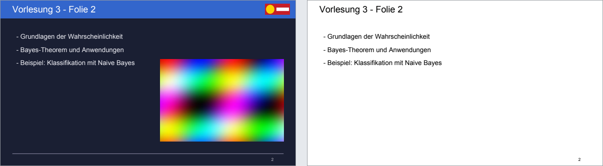

# PDF Distiller

[English](README.md) · **Deutsch** · [Türkçe](README.tr.md)

Entfernt dunkle Hintergründe, Designgrafiken, Logos und große Bilder aus Vorlesungsfolien, bevor Sie
sie drucken. Der Text bleibt scharf und lesbar, und der größte Teil der Tinte wird gespart. Alles läuft
auf Ihrem eigenen Rechner; Ihre PDFs werden nirgendwohin hochgeladen.



## Funktionen

- **Vier Stufen:** *Original*, *Leicht* (Hintergründe und wiederkehrende Designelemente),
  *Mittel* (+ große Bilder und Formen), *Maximal* (nur der Text bleibt).
- **Text bleibt Text.** Nichts wird gerastert, das Ergebnis ist ein Vektor-PDF. Heller Text auf
  entferntem dunklem Hintergrund wird automatisch schwarz.
- **Bilder mit Text** (Tabellen, Formeln, Screenshots) werden erkannt und behalten.
- **Per Klick:** jedes einzelne Element auf einer oder allen Seiten entfernen oder behalten.
  Kopf- und Fußzeilen nach Position entfernen, auch wenn sich die Seitenzahl ändert.
- **Verlustfreies Zuschneiden:** einen Teil eines Bildes behalten oder löschen (Rechteck oder
  Freihand), über einen PDF-Beschneidungspfad, ohne das Bild neu zu kodieren.
- **Drucklayout:** Graustufen, aufgehellte Bilder, 2/4/6 Seiten pro Blatt, Seiten löschen,
  sortieren und drehen.
- **Wortzähler** über alle Folien, mit CSV-Export.
- Oberfläche auf **Deutsch, Englisch und Türkisch**.

## Ergebnisse

Tintenersparnis, geschätzt durch Rendern der Seiten vorher und nachher (`python docs/readme_assets.py`).
Die Beispieldateien sind synthetisch und werden von `tests/make_samples.py` erzeugt.

| Beispiel | Leicht | Mittel | Maximal |
|---|---:|---:|---:|
| `dark_slides.pdf` – dunkles Design, Fotos | 91 % | 96 % | 98 % |
| `light_slides.pdf` – helles Design, farbige Kästen | 55 % | 89 % | 88 % |
| `beamer_slides.pdf` – Farbverlauf im LaTeX-Beamer-Stil | 99 % | 99 % | 99 % |
| `hochschule_slides.pdf` – Hochschulvorlage | 76 % | 76 % | 74 % |
| `mixed_images.pdf` – Screenshots und Tabellen | 0 % | 0 % | 15 % |

*Maximal* spart teils etwas weniger als *Mittel*, weil es zusätzlich allen Text schwarz macht.
`mixed_images.pdf` spart bewusst wenig: Die Bilder enthalten Text und werden behalten.

Geschwindigkeit mit einem synthetischen Foliensatz aus 500 Seiten und ~155.000 Vektorelementen
(`python bench.py`; Apple Silicon, 10 Kerne, Python 3.13): Analyse 2,4 s, Export 1,6–1,9 s,
Vorschau einer Seite 8 ms. Details: [README.md](README.md#results).

## Start

Voraussetzung: Python 3.10 oder neuer.

- **macOS:** `start_mac.command` doppelklicken. Bei einer Warnung wegen eines nicht verifizierten
  Entwicklers: Rechtsklick › *Öffnen*.
- **Windows:** `start_windows.bat` doppelklicken.
- **Manuell:**

```bash
python3 -m venv .venv && source .venv/bin/activate     # Windows: .venv\Scripts\activate
pip install -r requirements.txt
python run.py              # öffnet http://127.0.0.1:8765 im Browser
python run.py --window     # in einem eigenen Fenster (vorher: pip install pywebview)
```

Beim ersten Start wird eine lokale Umgebung eingerichtet (1–2 Minuten). Fertige Pakete ohne Python
sind geplant.

## Bedienung

1. PDF mit **PDF öffnen** oder per Drag & Drop laden.
2. Links eine **Stufe** wählen und feinjustieren: Schwellenwerte, Textfarbe, Graustufen,
   Bilder aufhellen, Seiten pro Blatt.
3. Farbige Rahmen in der Vorschau zeigen die gefundenen Elemente. Ein Klick wählt das **kleinste**
   Element unter dem Mauszeiger; im Menü können Sie es auf dieser oder allen Seiten entfernen oder
   behalten.
4. **Text wählen** (`T`): ein Textfeld anklicken oder einen Bereich aufziehen.
5. **Zuschneiden** (`C`): ein Bild anklicken und darüber ziehen. *Innen behalten* oder *Innen löschen*;
   *Automatisch: Fotos löschen* entfernt Fotobereiche und behält den Text.
6. Seiten rechts löschen, drehen und sortieren. **Rückgängig:** Strg/Cmd+Z.
7. Einstellungen als **Profil** speichern (`~/.pdf-distiller/profiles/`).
8. **Druck-PDF herunterladen.**

Funktionsweise, Entwicklung und bekannte Grenzen: siehe [README.md](README.md) (Englisch) und
[ARCHITECTURE.md](ARCHITECTURE.md).

## Lizenz

[MIT](LICENSE). Lizenzen von Drittanbietern: [THIRD_PARTY_NOTICES.md](THIRD_PARTY_NOTICES.md).
