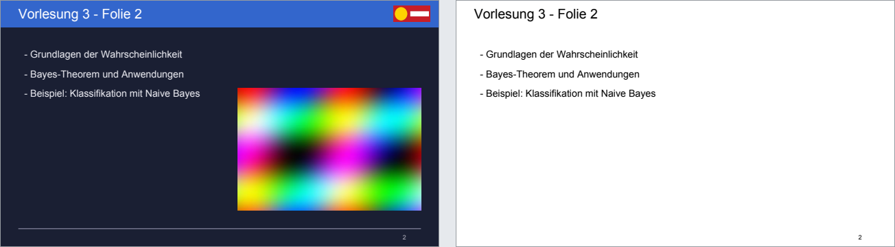

# PDF Distiller

**English** · [Deutsch](docs/README.de.md) · [Türkçe](docs/README.tr.md)

**Print lecture slides, not their backgrounds.** PDF Distiller removes dark backgrounds, repeated logos
and big photos from a PDF and keeps the text sharp. It runs on your own computer; your files are never
uploaded.

<p align="center"></p>

## Why I built it

I grew up in a family of teachers. Nobody ever handed me a blank sheet of paper without asking first:
*what are you going to do with it?* At university I still print my slides, because I think better with a
pen in my hand, and every dark slide spent most of the cartridge on backgrounds nobody reads.
PDF Distiller asks a PDF that same question before it prints. I use tablets too; this is not paper versus
screens. If you print, print only what you need. Each of us is a single dot. This is me doing my part.



## What happens inside

No AI model and no internet: a handful of readable rules, step by step.

<p align="center"></p>

## How I built it

1. **Measure the problem.** The app draws every page before and after and estimates the ink, so each
   choice shows what it saves. Dark slides save the most, plain ones less (measurements under *Results*).
2. **Set the constraints first.** Works offline. Text stays real text, never a picture of text.
   Libraries with permissive licences only. A one-click app for people who never open a terminal.
3. **Decide, and write down the cost.**

   | Decision | Why | What it costs |
   |---|---|---|
   | Edit the PDF's drawing instructions instead of re-drawing the page | Text stays sharp and searchable, files stay small | Every odd PDF has to be parsed: robustness work |
   | pikepdf + pypdfium2, not PyMuPDF ([ADR](docs/adr/0001-no-pymupdf.md)) | Permissive licences (PyMuPDF is AGPL) | Two libraries to glue together |
   | Hide removed text instead of deleting it | The rest of the line keeps its place | Hidden text is still searchable |
   | Measure ink on every page, not on a sample | A 24-page sample read 49 % ink where the whole 160-page deck uses 28 % | About 3.5 s per change on a 500-page deck (0.4 s on 60 pages) |
   | Spot text inside images by heuristics, no OCR | Fast, no large model to ship | Colourful diagrams can be misjudged |
   | One local web interface for browser and desktop | One code base, no build step | The download is about 38 MB |

4. **Check it.** Automated checks run on Linux, macOS and Windows with every change. Damaged and unusual
   PDFs from the pdf.js test collection were opened one by one ([report](docs/robustness.md)). Even a
   500-page deck is analysed in about two seconds.
5. **Build for people, not for myself.** Every action shows feedback, so the app never looks frozen.
   Messages never blame the user. The interface speaks English, German and Turkish, and works with a
   keyboard and a screen reader.

Rules for anyone who continues the work: [ARCHITECTURE.md](docs/ARCHITECTURE.md).

## Details

Click a heading to open it.

<details>
<summary><b>What it does</b></summary>

- **Four levels:** *Original*, *Light* (backgrounds and repeated theme elements),
  *Medium* (+ large images and shapes), *Maximum* (only the text remains).
- **Text stays text.** No rasterising: the output is a vector PDF. Light text on removed dark
  backgrounds is turned black automatically.
- **Images that contain text** (tables, formulas, screenshots) are recognised and kept; dark photos
  are still treated as photos.
- **Ink warnings:** pages that would use a lot of ink are flagged, and a list shows which elements
  cost the most, each removable with one click.
- **Point and click:** remove or keep any single element, on one page or on all pages.
  Remove headers and footers by position, even when the page number changes.
- **Lossless cropping:** keep or erase part of an image (rectangle or freehand) with a PDF clip
  path, without re-encoding the image.
- **Print layout:** grayscale, faded images, 2/4/6 pages per sheet, delete, reorder and rotate pages.
- **Word counter** across all slides, with CSV export.
- Interface in **English, German and Turkish**.

</details>

<details>
<summary><b>Results</b></summary>

Ink saving estimated by rendering pages before and after (`python docs/readme_assets.py`).
The sample decks are synthetic and generated by `tests/make_samples.py`.

| Sample | Light | Medium | Maximum |
|---|---:|---:|---:|
| `dark_slides.pdf` – dark theme, photos | 91% | 96% | 98% |
| `light_slides.pdf` – light theme, coloured boxes | 55% | 89% | 88% |
| `beamer_slides.pdf` – LaTeX Beamer-style gradient theme | 99% | 99% | 99% |
| `hochschule_slides.pdf` – university template | 76% | 76% | 74% |
| `mixed_images.pdf` – screenshots and tables | 0% | 0% | 15% |

*Maximum* can save slightly less than *Medium* because it also turns all text black.
`mixed_images.pdf` saves little by design: its images contain text and are kept.

Speed on a synthetic 500-page deck with ~155,000 vector elements (`python tools/bench.py`;
Apple Silicon, 10 cores, Python 3.13):

| Step | Time |
|---|---:|
| Analysis (incl. image content analysis) | 2.0 s |
| Export, Light / Medium / Maximum | 3.2 / 3.2 / 3.4 s |
| Export, Light + grayscale + 4 pages per sheet | 3.8 s |
| Ink estimate, every page (0.4 s on 60 pages) | 3.7 s |
| Single-page preview | 16 ms |

</details>

<details>
<summary><b>Download</b></summary>

Ready-to-run builds (no Python needed) are attached to each [release](../../releases):

- **macOS (Apple Silicon):** `PDF-Distiller-macOS.dmg`. Open it and drag *PDF Distiller* to *Applications*.
- **Windows:** `PDF-Distiller-Windows.zip`. Unzip it and run `PDF Distiller.exe`.

The builds are not code-signed, so the system warns on the first launch. This happens once:

- **macOS:** double-click the app; macOS says it cannot verify it. Click *Done*, open
  *System Settings › Privacy & Security*, scroll down to the message about *PDF Distiller* and click
  *Open Anyway*, then confirm with *Open*. (Or in Terminal:
  `xattr -dr com.apple.quarantine "/Applications/PDF Distiller.app"`.)
- **Windows:** SmartScreen shows *Windows protected your PC*. Click *More info*, then *Run anyway*.

The app opens in its own window; closing the window quits it.

</details>

<details>
<summary><b>Running from source</b></summary>

Requires Python 3.10 or newer.

- **macOS:** double-click `tools/start_mac.command`. If macOS warns about an unidentified developer,
  right-click it and choose *Open*.
- **Windows:** double-click `tools/start_windows.bat`.
- **Manually:**

```bash
python3 -m venv .venv && source .venv/bin/activate     # Windows: .venv\Scripts\activate
pip install -r requirements.txt
python run.py              # opens http://127.0.0.1:8765 in your browser
python run.py --window     # in its own window (first: pip install pywebview)
```

The first run sets up a local environment (1–2 minutes).

</details>

<details>
<summary><b>Using it</b></summary>

1. Open a PDF with **Open PDF** or drag and drop it.
2. Pick a **level** on the left and fine-tune: thresholds, text colour, grayscale, image fading,
   pages per sheet.
3. Coloured boxes in the preview mark the elements that were found. Click one: the **smallest**
   element under the cursor is selected, and the menu lets you remove or keep it on this page or on
   all pages.
4. **Select text** (`T`): click a text box or drag an area. *Remove on all pages* only removes the
   exact same text at the same position; *remove text at this position on every page* also catches
   footers whose page number changes.
5. **Crop** (`C`): click an image, then drag across it. The default is *Erase what I draw*; *Print
   only what I draw* keeps just that part. *Erase photos automatically* removes photo regions and
   keeps the text.
6. **Uses the most ink** (left): pages with heavy ink use are marked in red; the list shows the most
   expensive elements.
7. Delete, rotate and reorder pages in the right-hand strip. **Undo / redo:** Ctrl/Cmd+Z, Ctrl+Y or Cmd+Shift+Z.
8. Save your settings as a **profile** (`~/.pdf-distiller/profiles/`).
9. **Download print PDF.**

</details>

<details>
<summary><b>How it works</b></summary>

PDF Distiller does not render and re-trace pages. It walks each page's **content stream** operator
by operator, tracks the graphics state, and records every image, fill, stroke and shading with its
position, size, brightness and a signature for spotting repeated theme elements. Removing an element
means rewriting the stream without it. The same walker runs in both passes, so element ids always
match. Text is never deleted from the stream; it is made invisible so the rest of the line keeps its
position.

- Architecture and rules for contributors: [ARCHITECTURE.md](docs/ARCHITECTURE.md)
- Why pikepdf + pypdfium2 and not PyMuPDF: [docs/adr/0001-no-pymupdf.md](docs/adr/0001-no-pymupdf.md)

Built with [pikepdf](https://github.com/pikepdf/pikepdf) (qpdf) for parsing and rewriting,
[pypdfium2](https://github.com/pypdfium2-team/pypdfium2) (PDFium) for rendering and text,
FastAPI, and a plain JavaScript front end with no build step.

</details>

<details>
<summary><b>Development</b></summary>

```bash
pip install -r requirements-dev.txt
python -m pytest -q            # engine, server and translation tests
ruff check .                   # lint (config in pyproject.toml)
python tools/corpus_check.py --weird   # damaged/unusual PDFs end to end (see docs/robustness.md)
python tests/make_samples.py   # regenerate the sample decks in samples/
python tools/bench.py [file.pdf]     # speed benchmark (synthetic 500-page deck by default)
python docs/readme_assets.py   # regenerate the README image and ink table
python packaging/build.py      # build the .app/.dmg (macOS) or .exe (Windows); needs pyinstaller pywebview
```

Pushing a `v*` tag builds both packages in GitHub Actions and attaches them to a release.

CI runs ruff and the tests on Linux, macOS and Windows (Python 3.10 and 3.13).

UI text lives in `app/static/i18n/{en,de,tr}.json`; `tests/test_i18n.py` fails if a key is missing
from one language.

</details>

<details>
<summary><b>Known limitations</b></summary>

- Scanned PDFs (one image per page) cannot be split into elements; the whole image can only be
  removed or faded.
- Grayscale is not applied to gradients (shadings); levels can remove them instead.
- Removed text is invisible, not deleted: it is still searchable in the PDF but does not print.
  Bookmarks (outline) are not kept when the page order changes.
- Telling text from photos inside images is a heuristic without OCR: colourful diagrams may count
  as photos and very faint screenshots as text. Crop or keep by hand when unsure.
- The text colour decision is based on where a line starts; very long lines can occasionally be
  misjudged.
- Damaged PDFs are repaired where possible (1100 of the 1103 files in the pdf.js test corpus pass);
  a few files that crash or stall the renderer itself are listed in [docs/robustness.md](docs/robustness.md).

</details>

## License

[MIT](LICENSE). Third-party licenses: [THIRD_PARTY_NOTICES.md](docs/THIRD_PARTY_NOTICES.md).
