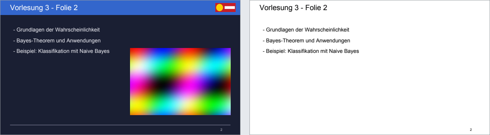

# PDF Distiller

[English](README.md) · [Deutsch](README.de.md) · **Türkçe**

Ders slaytlarını yazdırmadan önce koyu zeminleri, tema grafiklerini, logoları ve büyük görselleri
ayıklar. Metin keskin ve okunur kalır, mürekkebin büyük kısmı tasarruf edilir. Her şey kendi
bilgisayarınızda çalışır; PDF'leriniz hiçbir yere yüklenmez.



## Neler yapar

- **Dört kademe:** *Orijinal*, *Hafif* (zeminler ve tekrar eden tema öğeleri),
  *Orta* (+ büyük görseller ve şekiller), *Maksimum* (sadece metin kalır).
- **Metin metin olarak kalır.** Resme çevirme yok, çıktı vektör PDF'tir. Kaldırılan koyu zemin
  üzerindeki açık renkli metin otomatik siyaha döner.
- **Yazı içeren görseller** (tablo, formül, ekran görüntüsü) tanınır ve korunur.
- **Tıkla ve seç:** herhangi bir öğeyi bu sayfada veya tüm sayfalarda kaldır ya da koru. Üst/alt
  bilgiyi konumuna göre kaldır, sayfa numarası değişse bile.
- **Kayıpsız kırpma:** görselin bir kısmını bırak veya sil (dörtgen veya serbest), PDF kırpma
  yoluyla; görsel yeniden sıkıştırılmaz.
- **Baskı düzeni:** gri tonlama, soluk görseller, kâğıt başına 2/4/6 sayfa, sayfa silme, sıralama
  ve döndürme.
- Tüm slaytlarda **kelime sayacı**, CSV olarak indirilebilir.
- Arayüz **Türkçe, İngilizce ve Almanca**.

## Sonuçlar

Mürekkep tasarrufu, sayfaları önce ve sonra render ederek tahmin edilir (`python docs/readme_assets.py`).
Örnek dosyalar sentetiktir ve `tests/make_samples.py` ile üretilir.

| Örnek | Hafif | Orta | Maksimum |
|---|---:|---:|---:|
| `dark_slides.pdf` – koyu tema, fotoğraflar | %91 | %96 | %98 |
| `light_slides.pdf` – açık tema, renkli kutular | %55 | %89 | %88 |
| `beamer_slides.pdf` – LaTeX Beamer tarzı gradyan tema | %99 | %99 | %99 |
| `hochschule_slides.pdf` – üniversite şablonu | %76 | %76 | %74 |
| `mixed_images.pdf` – ekran görüntüleri ve tablolar | %0 | %0 | %15 |

*Maksimum* bazen *Orta*'dan biraz az tasarruf eder, çünkü tüm metni de siyaha çevirir.
`mixed_images.pdf` bilerek az tasarruf eder: görsellerinde yazı var, korunurlar.

Hız, 500 sayfalık ve ~155.000 vektör öğeli sentetik bir destede (`python bench.py`; Apple Silicon,
10 çekirdek, Python 3.13): analiz 2,4 sn, dışa aktarma 1,6–1,9 sn, tek sayfa önizleme 8 ms.
Ayrıntılar: [README.md](README.md#results).

## İndir

Python gerektirmeyen hazır paketler her [sürümde](../../releases) bulunur:

- **macOS (Apple Silicon):** `PDF-Distiller-macOS.dmg` dosyasını açın, *PDF Distiller*'ı *Uygulamalar*'a sürükleyin.
- **Windows:** `PDF-Distiller-Windows.zip` dosyasını açın, `PDF Distiller.exe`'yi çalıştırın.

Paketler imzalı değil, bu yüzden sistem ilk açılışta uyarır. Bu yalnızca bir kez gerekir:

- **macOS:** Uygulamaya çift tıklayın; macOS doğrulanamadığını söyler. *Bitti*'ye tıklayın,
  *Sistem Ayarları › Gizlilik ve Güvenlik*'i açın, aşağıdaki *PDF Distiller* uyarısına inip
  *Yine de Aç*'a tıklayın ve *Aç* ile onaylayın. (Ya da Terminal'de:
  `xattr -dr com.apple.quarantine "/Applications/PDF Distiller.app"`.)
- **Windows:** SmartScreen *Windows bilgisayarınızı korudu* der. *Ek bilgi*'ye, sonra *Yine de çalıştır*'a tıklayın.

Uygulama kendi penceresinde açılır; pencereyi kapatınca uygulama da kapanır.

## Kaynak koddan çalıştırma

Gerekli: Python 3.10 veya üstü.

- **macOS:** `start_mac.command` dosyasına çift tıklayın. "Tanımlanmamış geliştirici" uyarısı
  çıkarsa: sağ tık › *Aç*.
- **Windows:** `start_windows.bat` dosyasına çift tıklayın.
- **Elle:**

```bash
python3 -m venv .venv && source .venv/bin/activate     # Windows: .venv\Scripts\activate
pip install -r requirements.txt
python run.py              # tarayıcıda http://127.0.0.1:8765 açar
python run.py --window     # ayrı pencerede (önce: pip install pywebview)
```

İlk çalıştırmada yerel bir ortam kurulur (1–2 dakika).

## Kullanım

1. **PDF aç** ile veya sürükle-bırak ile dosyayı yükleyin.
2. Soldan bir **kademe** seçin ve ince ayar yapın: eşikler, metin rengi, gri tonlama, görsel
   soldurma, kâğıt başına sayfa.
3. Önizlemedeki renkli kutular bulunan öğelerdir. Tıkladığınız noktadaki **en küçük** öğe seçilir;
   menüden bu sayfada veya tüm sayfalarda kaldırıp koruyabilirsiniz.
4. **Metin seç** (`T`): bir metin kutusuna tıklayın veya sürükleyerek alan seçin.
5. **Kırp** (`K`): bir görsele tıklayın, sonra üzerinde sürükleyin. *İçini bırak* veya *İçini sil*;
   *Otomatik: fotoğrafları sil* fotoğraf bölgelerini siler, yazıyı bırakır.
6. Sağ şeritte sayfaları silin, döndürün, sıralayın. **Geri al:** Ctrl/Cmd+Z.
7. Ayarları **profil** olarak kaydedin (`~/.pdf-distiller/profiles/`).
8. **Baskı PDF'ini indir.**

Nasıl çalıştığı, geliştirme ve bilinen sınırlar için: [README.md](README.md) (İngilizce) ve
[ARCHITECTURE.md](ARCHITECTURE.md).

## Lisans

[MIT](LICENSE). Üçüncü taraf lisansları: [THIRD_PARTY_NOTICES.md](THIRD_PARTY_NOTICES.md).
