# PDF Distiller

[English](../README.md) · **Deutsch** · [Türkçe](README.tr.md)

**Folien drucken, nicht ihre Hintergründe.** PDF Distiller entfernt dunkle Hintergründe, wiederholte
Logos und große Fotos aus einem PDF und lässt den Text scharf. Es läuft auf Ihrem eigenen Rechner; Ihre
Dateien werden nirgendwohin hochgeladen.

<p align="center"></p>

## Warum ich es gebaut habe

Etwas besitzen zu wollen ist vielleicht eines der ursprünglichsten Gefühle des Menschen. Was wir in der Hand halten und beschreiben können, gehört uns; vielleicht kommen wir deshalb selbst im digitalen Zeitalter nicht vom Ausdrucken los. Wollten Sie schon einmal etwas vom Bildschirm ausdrucken und mussten erst das Überflüssige aussortieren? Wie im echten Leben. 😃

Ich komme aus einer Lehrerfamilie, und der achtsame Umgang meiner Eltern mit Papier hat auf mich abgefärbt. Als Kind bekam ich nie einfach ein leeres, weißes Blatt. Zuerst kam die Frage: *Was willst du damit machen?* Meistens malte ich auf Schmierpapier. In diesem Alter war das ein einfaches, gelebtes Beispiel für das, was wir heute Nachhaltigkeit nennen.

Wie schnell sind wir vom Rascheln der Seiten in Hochschulfluren dort angekommen, wo wir wie ein Specht auf Tablet-Bildschirme tippen. Ich habe selbst mehrere Tablets großer Marken benutzt; es geht nicht um Papier gegen Bildschirm. Aber etwas auszudrucken ist etwas anderes: Die Art des Stifts verändert, was Sie schreiben können, ein Tropfen Kaffee landet auf der Seite, und je nachdem, wie Sie es nutzen, wird das Blatt abgegriffen und ein Stück von Ihnen. Wenn ich an die Verbindung zwischen unseren Händen und unserem Geist denke, fällt mir der [sensorische Homunculus](https://www.google.com/search?q=sensorischer+Homunculus&tbm=isch) ein, ein Modell, das ich in der Schulzeit in einem Lehrbuch gesehen habe. In den 1930er-Jahren operierte der Neurochirurg Wilder Penfield Epilepsiepatienten, die dabei wach waren. Er reizte die Oberfläche ihres Gehirns mit einem schwachen Strom und fragte, wo im Körper sie etwas spürten. Mit ihren Antworten zeigte er, wie viel Fläche jeder Körperteil beim Tastsinn im Gehirn einnimmt. Damit man es sich leicht merken kann, zeichnete Penfield daraus eine Figur: jeder Körperteil so groß wie seine Fläche im Gehirn. Heraus kam ein kleiner Mensch mit riesigen Händen. Diese Figur erinnert mich daran, unsere Hände als das Organ zu sehen, durch das unsere Kreativität die Welt erreicht. Jede Spur, die wir auf Papier hinterlassen, fühlt sich an, als füge sie unserem Gehirn eine Windung hinzu. Deshalb drucke ich meine Folien bis heute aus.

Aber Vorlesungsfolien sind für die Leinwand im Hörsaal gemacht, nicht für Papier. Der Großteil der Tinte fließt in dunkle Hintergründe, wiederkehrende Logos und große Fotos. Ich weiß, dass sie in der Vorlesung einen Zweck haben: Sie helfen Studierenden, den Stoff besser zu verstehen. Auf Papier verlieren sie diese Aufgabe jedoch; übrig bleibt nur die verbrauchte Tinte. Lassen Sie sich diese Elemente vor dem Druck von PDF Distiller einzeln zeigen, und entscheiden Sie selbst, was bleibt: Vermeiden Sie Verschwendung, verbrauchen Sie weniger Tinte und schonen Sie so Umwelt und Geldbeutel.

Kurz gesagt: Mit diesem Projekt wollte ich ein Problem, auf das ich als Einzelperson gestoßen bin, auf eine gesellschaftliche Ebene bringen.


## Was im Inneren passiert

Kein KI-Modell, kein Internet: ein paar lesbare Regeln, Schritt für Schritt.

<p align="center"></p>

## Wie ich es gebaut habe

1. **Das Problem messen.** Die App zeichnet jede Seite vorher und nachher und schätzt die Tinte, damit jede
   Entscheidung zeigt, was sie spart. Dunkle Folien sparen am meisten, schlichte weniger (Messungen unter *Ergebnisse*).
2. **Zuerst die Rahmenbedingungen.** Funktioniert offline. Text bleibt echter Text, nie ein Bild von Text.
   Nur Bibliotheken mit freizügigen Lizenzen. Eine App mit einem Klick für Menschen, die nie ein Terminal
   öffnen.
3. **Entscheiden und den Preis aufschreiben.**

   | Entscheidung | Warum | Was sie kostet |
   |---|---|---|
   | Die Zeichenbefehle des PDFs bearbeiten statt die Seite neu zu zeichnen | Text bleibt scharf und durchsuchbar, Dateien bleiben klein | Jedes ungewöhnliche PDF muss gelesen werden: Robustheitsarbeit |
   | pikepdf + pypdfium2 statt PyMuPDF ([ADR](adr/0001-no-pymupdf.md)) | Freizügige Lizenzen (PyMuPDF steht unter AGPL) | Zwei Bibliotheken müssen zusammenspielen |
   | Entfernten Text ausblenden statt löschen | Der Rest der Zeile bleibt an seinem Platz | Ausgeblendeter Text bleibt durchsuchbar |
   | Tinte auf jeder Seite messen, nicht an einer Stichprobe | Eine Stichprobe von 24 Seiten ergab 49 % Tinte, der ganze Foliensatz mit 160 Seiten braucht 28 % | Etwa 3,5 s pro Änderung bei 500 Seiten (0,4 s bei 60 Seiten) |
   | Text in Bildern per Heuristik erkennen, ohne OCR | Schnell, kein großes Modell nötig | Bunte Diagramme können falsch eingeordnet werden |
   | Eine lokale Weboberfläche für Browser und Desktop | Eine Codebasis, kein Build-Schritt | Der Download ist etwa 38 MB groß |

4. **Prüfen.** Automatische Prüfungen laufen bei jeder Änderung unter Linux, macOS und Windows. Beschädigte
   und ungewöhnliche PDFs aus der Testsammlung von pdf.js wurden einzeln geöffnet ([Bericht](robustness.md),
   Englisch). Selbst ein Foliensatz mit 500 Seiten ist in etwa zwei Sekunden analysiert.
5. **Für Menschen bauen, nicht für mich.** Jede Aktion gibt Rückmeldung, damit die App nie eingefroren
   wirkt. Meldungen geben nie dem Nutzer die Schuld. Die Oberfläche spricht Deutsch, Englisch und
   Türkisch und lässt sich mit Tastatur und Screenreader bedienen.

Regeln für alle, die weiterarbeiten: [ARCHITECTURE.md](ARCHITECTURE.md) (Englisch).

## Details

Zum Aufklappen auf eine Überschrift klicken.

<details>
<summary><b>Funktionen</b></summary>

- **Vier Stufen:** *Original*, *Leicht* (Hintergründe und wiederkehrende Designelemente),
  *Mittel* (+ große Bilder und Formen), *Maximal* (nur der Text bleibt).
- **Text bleibt Text.** Nichts wird gerastert, das Ergebnis ist ein Vektor-PDF. Heller Text auf
  entferntem dunklem Hintergrund wird automatisch schwarz.
- **Bilder mit Text** (Tabellen, Formeln, Screenshots) werden erkannt und beibehalten; dunkle Fotos
  werden trotzdem als Fotos behandelt.
- **Tintenwarnung:** Seiten, die viel Tinte verbrauchen würden, werden markiert, und eine Liste zeigt,
  welche Elemente am meisten kosten – mit einem Klick entfernt.
- **Per Klick:** jedes einzelne Element auf einer oder allen Seiten entfernen oder behalten.
  Kopf- und Fußzeilen nach Position entfernen, auch wenn sich die Seitenzahl ändert.
- **Verlustfreies Zuschneiden:** einen Teil eines Bildes behalten oder löschen (Rechteck oder
  Freihand), über einen PDF-Beschneidungspfad, ohne das Bild neu zu kodieren.
- **Drucklayout:** Graustufen, aufgehellte Bilder, 2/4/6 Seiten pro Blatt, Seiten löschen,
  sortieren und drehen.
- **Wortzähler** über alle Folien, mit CSV-Export.
- Oberfläche auf **Deutsch, Englisch und Türkisch**.

</details>

<details>
<summary><b>Ergebnisse</b></summary>

Tintenersparnis, geschätzt durch Rendern der Seiten vorher und nachher (`python docs/readme_assets.py`).
Die Beispieldateien sind synthetisch und werden von `tests/make_samples.py` erzeugt.

| Beispiel | Leicht | Mittel | Maximal |
|---|---:|---:|---:|
| `dark_slides.pdf` – dunkles Design, Fotos | 91 % | 96 % | 98 % |
| `light_slides.pdf` – helles Design, farbige Kästen | 55 % | 89 % | 88 % |
| `beamer_slides.pdf` – Farbverlauf im LaTeX-Beamer-Stil | 99 % | 99 % | 99 % |
| `hochschule_slides.pdf` – Hochschulvorlage | 76 % | 76 % | 74 % |
| `mixed_images.pdf` – Screenshots und Tabellen | 0 % | 0 % | 15 % |

*Maximal* spart teils etwas weniger als *Mittel*, weil es zusätzlich allen Text schwarz macht.
`mixed_images.pdf` spart bewusst wenig: Die Bilder enthalten Text und werden behalten.

Geschwindigkeit mit einem synthetischen Foliensatz aus 500 Seiten und ~155.000 Vektorelementen
(`python tools/bench.py`; Apple Silicon, 10 Kerne, Python 3.13): Analyse 2,0 s, Export 3,2–3,8 s,
Tintenschätzung über alle Seiten 3,7 s (bei 60 Seiten 0,4 s), Vorschau einer Seite 16 ms. Details: [README.md](../README.md).

</details>

<details>
<summary><b>Download</b></summary>

Fertige Pakete (ohne Python) liegen jedem [Release](../../../releases) bei:

- **macOS (Apple Silicon):** `PDF-Distiller-macOS.dmg` öffnen und *PDF Distiller* in *Programme* ziehen.
- **Windows:** `PDF-Distiller-Windows.zip` entpacken und `PDF Distiller.exe` starten.

Die Pakete sind nicht signiert, daher warnt das System beim ersten Start. Das ist nur einmal nötig:

- **macOS:** App doppelklicken; macOS meldet, dass sie nicht überprüft werden kann. *Fertig* klicken,
  *Systemeinstellungen › Datenschutz & Sicherheit* öffnen, nach unten zum Hinweis auf *PDF Distiller*
  scrollen, *Dennoch öffnen* klicken und mit *Öffnen* bestätigen. (Oder im Terminal:
  `xattr -dr com.apple.quarantine "/Applications/PDF Distiller.app"`.)
- **Windows:** SmartScreen zeigt *Der Computer wurde durch Windows geschützt*. Auf *Weitere
  Informationen* und dann *Trotzdem ausführen* klicken.

Die App öffnet sich in einem eigenen Fenster; Schließen des Fensters beendet sie.

</details>

<details>
<summary><b>Aus dem Quellcode starten</b></summary>

Voraussetzung: Python 3.10 oder neuer.

- **macOS:** `tools/start_mac.command` doppelklicken. Bei einer Warnung wegen eines nicht verifizierten
  Entwicklers: Rechtsklick › *Öffnen*.
- **Windows:** `tools/start_windows.bat` doppelklicken.
- **Manuell:**

```bash
python3 -m venv .venv && source .venv/bin/activate     # Windows: .venv\Scripts\activate
pip install .
python run.py              # öffnet http://127.0.0.1:8765 im Browser
python run.py --window     # in einem eigenen Fenster (vorher: pip install ".[window]")
```

Beim ersten Start wird eine lokale Umgebung eingerichtet (1–2 Minuten).

</details>

<details>
<summary><b>Bedienung</b></summary>

1. PDF mit **PDF öffnen** oder per Drag & Drop laden.
2. Links eine **Stufe** wählen und feinjustieren: Schwellenwerte, Textfarbe, Graustufen,
   Bilder aufhellen, Seiten pro Blatt.
3. Farbige Rahmen in der Vorschau zeigen die gefundenen Elemente. Ein Klick wählt das **kleinste**
   Element unter dem Mauszeiger; im Menü können Sie es auf dieser oder allen Seiten entfernen oder
   behalten.
4. **Text auswählen** (`T`): ein Textfeld anklicken oder einen Bereich aufziehen.
5. **Zuschneiden** (`C`): ein Bild anklicken und darüber ziehen. Standard ist *Das Gezeichnete löschen*;
   *Nur das Gezeichnete drucken* behält nur diesen Teil. *Fotos automatisch löschen* entfernt
   Fotobereiche und behält den Text.
6. **Verbraucht die meiste Tinte** (links): Seiten mit hohem Tintenverbrauch sind rot markiert;
   die Liste zeigt die teuersten Elemente.
7. Seiten rechts löschen, drehen und sortieren. **Rückgängig / Wiederholen:** Strg/Cmd+Z, Strg+Y oder Cmd+Umschalt+Z.
8. Einstellungen als **Profil** speichern (`~/.pdf-distiller/profiles/`).
9. **Druck-PDF herunterladen.**

Funktionsweise, Entwicklung und bekannte Grenzen: siehe [README.md](../README.md) (Englisch) und
[ARCHITECTURE.md](ARCHITECTURE.md).

</details>

## Lizenz

[MIT](../LICENSE). Lizenzen von Drittanbietern: [THIRD_PARTY_NOTICES.md](THIRD_PARTY_NOTICES.md).
