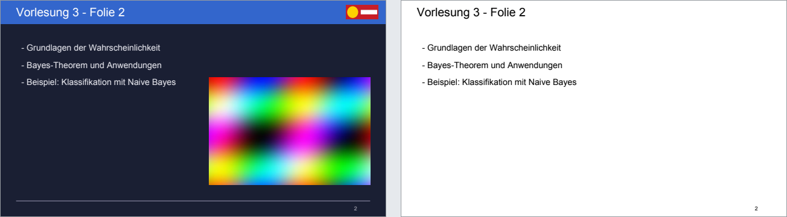

# PDF Distiller

[English](../README.md) · **Deutsch** · [Türkçe](README.tr.md)

**Folien drucken, nicht ihre Hintergründe.** PDF Distiller entfernt dunkle Hintergründe, wiederholte
Logos und große Fotos aus einem PDF und lässt den Text scharf. Es läuft auf Ihrem eigenen Rechner; Ihre
Dateien werden nirgendwohin hochgeladen.

<p align="center"></p>

## Warum ich es gebaut habe

Ich komme aus einer Lehrerfamilie. Ein leeres Blatt Papier bekam ich nie, ohne dass man mich vorher fragte:
*Was willst du damit machen?* Im Studium drucke ich meine Folien immer noch aus, weil ich mit einem Stift
in der Hand besser denke, und jede dunkle Folie hat den Großteil der Patrone für Hintergründe verbraucht,
die niemand liest. PDF Distiller stellt einem PDF vor dem Druck dieselbe Frage. Ich nutze auch Tablets;
es geht nicht um Papier gegen Bildschirm. Wenn Sie drucken, dann nur, was Sie brauchen. Jeder von uns ist
ein einzelner Punkt. Das hier ist mein Beitrag.



## Was im Inneren passiert

Kein KI-Modell, kein Internet: ein paar lesbare Regeln, Schritt für Schritt.

<p align="center"></p>

## Wie ich es gebaut habe

1. **Das Problem messen.** Die App zeichnet jede Seite vorher und nachher und schätzt die Tinte, damit jede
   Entscheidung zeigt, was sie spart. Dunkle Folien sparen am meisten, schlichte weniger (Messungen unter *Ergebnisse*).
2. **Zuerst die Rahmenbedingungen.** Funktioniert offline. Text bleibt echter Text, nie ein Bild von Text.
   Nur Bibliotheken mit freizügigen Lizenzen. Eine App mit einem Klick für Menschen, die nie ein Terminal
   öffnen.
3. **Entscheiden und den Preis aufschreiben.**

   | Entscheidung | Warum | Was sie kostet |
   |---|---|---|
   | Die Zeichenbefehle des PDFs bearbeiten statt die Seite neu zu zeichnen | Text bleibt scharf und durchsuchbar, Dateien bleiben klein | Jedes ungewöhnliche PDF muss gelesen werden: Robustheitsarbeit |
   | pikepdf + pypdfium2 statt PyMuPDF ([ADR](adr/0001-no-pymupdf.md)) | Freizügige Lizenzen (PyMuPDF steht unter AGPL) | Zwei Bibliotheken müssen zusammenspielen |
   | Entfernten Text ausblenden statt löschen | Der Rest der Zeile bleibt an seinem Platz | Ausgeblendeter Text bleibt durchsuchbar |
   | Tinte auf jeder Seite messen, nicht an einer Stichprobe | Eine Stichprobe von 24 Seiten ergab 49 % Tinte, der ganze Foliensatz mit 160 Seiten braucht 28 % | Etwa 3,5 s pro Änderung bei 500 Seiten (0,4 s bei 60 Seiten) |
   | Text in Bildern per Heuristik erkennen, ohne OCR | Schnell, kein großes Modell nötig | Bunte Diagramme können falsch eingeordnet werden |
   | Eine lokale Weboberfläche für Browser und Desktop | Eine Codebasis, kein Build-Schritt | Der Download ist etwa 38 MB groß |

4. **Prüfen.** Automatische Prüfungen laufen bei jeder Änderung unter Linux, macOS und Windows. Beschädigte
   und ungewöhnliche PDFs aus der Testsammlung von pdf.js wurden einzeln geöffnet ([Bericht](robustness.md),
   Englisch). Selbst ein Foliensatz mit 500 Seiten ist in etwa zwei Sekunden analysiert.
5. **Für Menschen bauen, nicht für mich.** Jede Aktion gibt Rückmeldung, damit die App nie eingefroren
   wirkt. Meldungen geben nie dem Nutzer die Schuld. Die Oberfläche spricht Deutsch, Englisch und
   Türkisch und lässt sich mit Tastatur und Screenreader bedienen.

Regeln für alle, die weiterarbeiten: [ARCHITECTURE.md](ARCHITECTURE.md) (Englisch).

## Details

Zum Aufklappen auf eine Überschrift klicken.

<details>
<summary><b>Funktionen</b></summary>

- **Vier Stufen:** *Original*, *Leicht* (Hintergründe und wiederkehrende Designelemente),
  *Mittel* (+ große Bilder und Formen), *Maximal* (nur der Text bleibt).
- **Text bleibt Text.** Nichts wird gerastert, das Ergebnis ist ein Vektor-PDF. Heller Text auf
  entferntem dunklem Hintergrund wird automatisch schwarz.
- **Bilder mit Text** (Tabellen, Formeln, Screenshots) werden erkannt und beibehalten; dunkle Fotos
  werden trotzdem als Fotos behandelt.
- **Tintenwarnung:** Seiten, die viel Tinte verbrauchen würden, werden markiert, und eine Liste zeigt,
  welche Elemente am meisten kosten – mit einem Klick entfernt.
- **Per Klick:** jedes einzelne Element auf einer oder allen Seiten entfernen oder behalten.
  Kopf- und Fußzeilen nach Position entfernen, auch wenn sich die Seitenzahl ändert.
- **Verlustfreies Zuschneiden:** einen Teil eines Bildes behalten oder löschen (Rechteck oder
  Freihand), über einen PDF-Beschneidungspfad, ohne das Bild neu zu kodieren.
- **Drucklayout:** Graustufen, aufgehellte Bilder, 2/4/6 Seiten pro Blatt, Seiten löschen,
  sortieren und drehen.
- **Wortzähler** über alle Folien, mit CSV-Export.
- Oberfläche auf **Deutsch, Englisch und Türkisch**.

</details>

<details>
<summary><b>Ergebnisse</b></summary>

Tintenersparnis, geschätzt durch Rendern der Seiten vorher und nachher (`python docs/readme_assets.py`).
Die Beispieldateien sind synthetisch und werden von `tests/make_samples.py` erzeugt.

| Beispiel | Leicht | Mittel | Maximal |
|---|---:|---:|---:|
| `dark_slides.pdf` – dunkles Design, Fotos | 91 % | 96 % | 98 % |
| `light_slides.pdf` – helles Design, farbige Kästen | 55 % | 89 % | 88 % |
| `beamer_slides.pdf` – Farbverlauf im LaTeX-Beamer-Stil | 99 % | 99 % | 99 % |
| `hochschule_slides.pdf` – Hochschulvorlage | 76 % | 76 % | 74 % |
| `mixed_images.pdf` – Screenshots und Tabellen | 0 % | 0 % | 15 % |

*Maximal* spart teils etwas weniger als *Mittel*, weil es zusätzlich allen Text schwarz macht.
`mixed_images.pdf` spart bewusst wenig: Die Bilder enthalten Text und werden behalten.

Geschwindigkeit mit einem synthetischen Foliensatz aus 500 Seiten und ~155.000 Vektorelementen
(`python tools/bench.py`; Apple Silicon, 10 Kerne, Python 3.13): Analyse 2,0 s, Export 3,2–3,8 s,
Tintenschätzung über alle Seiten 3,7 s (bei 60 Seiten 0,4 s), Vorschau einer Seite 16 ms. Details: [README.md](../README.md).

</details>

<details>
<summary><b>Download</b></summary>

Fertige Pakete (ohne Python) liegen jedem [Release](../../../releases) bei:

- **macOS (Apple Silicon):** `PDF-Distiller-macOS.dmg` öffnen und *PDF Distiller* in *Programme* ziehen.
- **Windows:** `PDF-Distiller-Windows.zip` entpacken und `PDF Distiller.exe` starten.

Die Pakete sind nicht signiert, daher warnt das System beim ersten Start. Das ist nur einmal nötig:

- **macOS:** App doppelklicken; macOS meldet, dass sie nicht überprüft werden kann. *Fertig* klicken,
  *Systemeinstellungen › Datenschutz & Sicherheit* öffnen, nach unten zum Hinweis auf *PDF Distiller*
  scrollen, *Dennoch öffnen* klicken und mit *Öffnen* bestätigen. (Oder im Terminal:
  `xattr -dr com.apple.quarantine "/Applications/PDF Distiller.app"`.)
- **Windows:** SmartScreen zeigt *Der Computer wurde durch Windows geschützt*. Auf *Weitere
  Informationen* und dann *Trotzdem ausführen* klicken.

Die App öffnet sich in einem eigenen Fenster; Schließen des Fensters beendet sie.

</details>

<details>
<summary><b>Aus dem Quellcode starten</b></summary>

Voraussetzung: Python 3.10 oder neuer.

- **macOS:** `tools/start_mac.command` doppelklicken. Bei einer Warnung wegen eines nicht verifizierten
  Entwicklers: Rechtsklick › *Öffnen*.
- **Windows:** `tools/start_windows.bat` doppelklicken.
- **Manuell:**

```bash
python3 -m venv .venv && source .venv/bin/activate     # Windows: .venv\Scripts\activate
pip install -r requirements.txt
python run.py              # öffnet http://127.0.0.1:8765 im Browser
python run.py --window     # in einem eigenen Fenster (vorher: pip install pywebview)
```

Beim ersten Start wird eine lokale Umgebung eingerichtet (1–2 Minuten).

</details>

<details>
<summary><b>Bedienung</b></summary>

1. PDF mit **PDF öffnen** oder per Drag & Drop laden.
2. Links eine **Stufe** wählen und feinjustieren: Schwellenwerte, Textfarbe, Graustufen,
   Bilder aufhellen, Seiten pro Blatt.
3. Farbige Rahmen in der Vorschau zeigen die gefundenen Elemente. Ein Klick wählt das **kleinste**
   Element unter dem Mauszeiger; im Menü können Sie es auf dieser oder allen Seiten entfernen oder
   behalten.
4. **Text auswählen** (`T`): ein Textfeld anklicken oder einen Bereich aufziehen.
5. **Zuschneiden** (`C`): ein Bild anklicken und darüber ziehen. Standard ist *Das Gezeichnete löschen*;
   *Nur das Gezeichnete drucken* behält nur diesen Teil. *Fotos automatisch löschen* entfernt
   Fotobereiche und behält den Text.
6. **Verbraucht die meiste Tinte** (links): Seiten mit hohem Tintenverbrauch sind rot markiert;
   die Liste zeigt die teuersten Elemente.
7. Seiten rechts löschen, drehen und sortieren. **Rückgängig / Wiederholen:** Strg/Cmd+Z, Strg+Y oder Cmd+Umschalt+Z.
8. Einstellungen als **Profil** speichern (`~/.pdf-distiller/profiles/`).
9. **Druck-PDF herunterladen.**

Funktionsweise, Entwicklung und bekannte Grenzen: siehe [README.md](../README.md) (Englisch) und
[ARCHITECTURE.md](ARCHITECTURE.md).

</details>

## Lizenz

[MIT](../LICENSE). Lizenzen von Drittanbietern: [THIRD_PARTY_NOTICES.md](THIRD_PARTY_NOTICES.md).
