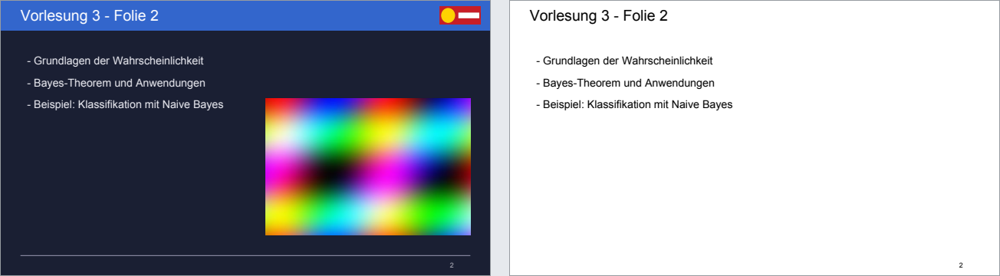

# PDF Distiller

[English](../README.md) · [Deutsch](README.de.md) · **Türkçe**

**Slaytları basın, arka planlarını değil.** PDF Distiller bir PDF'teki koyu arka planları, tekrar eden
logoları ve büyük fotoğrafları ayıklar, metni keskin bırakır. Kendi bilgisayarınızda çalışır; dosyalarınız
internete yüklenmez.

<p align="center"></p>

## Neden yaptım

Sahip olmak, belki de insanoğlunun en ilkel duygularından biri. Elimizde tutabildiğimiz, üstüne yazabildiğimiz şey bizimdir; belki de bu yüzden dijital çağda bile çıktı almaktan vazgeçemiyoruz. Ekranda gördüğünüz bir şeyin çıktısını almaya niyetlendiğinizde, gereksiz kısımları ayıklamak zorunda kaldığınız oldu mu? Tıpkı hayat gibi. 😃

Öğretmen bir aileden geliyorum; annemle babamın kâğıda olan hassasiyeti bana da geçti. Çocukken bana hiçbir zaman doğrudan bomboş, bembeyaz bir kâğıt verilmezdi. Önce sorarlardı: *Bununla ne yapacaksın?* Genelde müsvedde kâğıtlara çizerdim. Bu alışkanlık, bugün sürdürülebilirlik dediğimiz şeyin o yaşlardaki basit, uygulamalı bir örneğiydi.

Üniversite koridorlarındaki sayfa seslerinden, tablet ekranlarına bir ağaçkakan gibi vurduğumuz bu günlere ne çabuk geldik. Ben de büyük markaların birkaç tabletini kullandım; bu bir kâğıt-ekran kavgası değil. Ama bir şeyin çıktısını almak başka: tuttuğunuz kalemin türü yazabileceğinizi değiştirir, sayfaya bir damla kahve düşer, kullanım senaryonuza göre yıpranır ve sizleşir. Ellerimizin zihnimizle bağını düşününce aklıma lisede ders çalıştığım bir kaynakta gördüğüm [duyusal homunculus](https://www.google.com/search?q=duyusal+homunculus&tbm=isch) modeli gelir. 1930'larda beyin cerrahı Wilder Penfield, epilepsi ameliyatlarında uyanık hastaların beyin yüzeyine zayıf bir akım verdi ve onlara bedenlerinin neresinde bir şey hissettiklerini sordu. Bu cevaplarla, dokunma duyusunda bedenin her bölgesinin beyinde ne kadar alan kapladığını gösterdi. Penfield bunu akılda kalsın diye bir figürle resmetti: her organ, beyinde kapladığı alan kadar büyük çizildi ve ortaya elleri kocaman bir insan çıktı. Bu figür bana ellerimizi, yaratıcılığımızın dünyaya açılan uzvu olarak görmeyi hatırlatır. Kâğıtta bıraktığımız her iz, zihnimize de bir kıvrım ekliyormuş gibi gelir. Bu yüzden slaytlarımı hâlâ basıyorum.

Ama ders slaytları kâğıt için değil, amfideki perde için hazırlanır. Mürekkebin büyük kısmı koyu arka planlara, tekrar eden logolara ve büyük fotoğraflara gider. Bunların derste bir amacı olduğunu biliyorum: öğrencinin konuyu daha iyi kavramasına yardım ederler. Ancak kâğıtta bu işlevlerini yitirirler; geriye yalnızca harcanan mürekkep kalır. PDF Distiller, basmadan önce bu öğeleri size tek tek göstersin; neyin kalacağına siz karar verin; israfı azaltarak, daha az mürekkep sarfiyatıyla hem çevreyi hem cebinizi koruyun.

Kısacası, birey olarak karşılaştığım bir sorunu bu projeyle toplumsal ölçeğe taşımak istedim.



## İçeride neler oluyor

Yapay zekâ modeli yok, internet yok: adım adım, okunabilir birkaç kural.

<p align="center"></p>

## Nasıl yaptım

1. **Önce sorunu ölç.** Uygulama her sayfayı önce ve sonra çizip mürekkebi tahmin ediyor; böylece her seçim
   ne kazandırdığını gösteriyor. Koyu slaytlar en çok, sade slaytlar daha az tasarruf ediyor (ölçümler *Sonuçlar* altında).
2. **Sınırları baştan koy.** İnternetsiz çalışsın. Metin gerçek metin olarak kalsın, metnin resmine
   dönüşmesin. Yalnız serbest lisanslı kütüphaneler. Terminal açmayan biri için tek tıkla açılan bir uygulama.
3. **Karar ver ve bedelini yaz.**

   | Karar | Neden | Bedeli |
   |---|---|---|
   | Sayfayı yeniden çizmek yerine PDF'in çizim komutlarını düzenlemek | Metin keskin ve aranabilir kalır, dosya küçük kalır | Her tuhaf PDF'in okunması gerekir: sağlamlık işi |
   | PyMuPDF yerine pikepdf + pypdfium2 ([ADR](adr/0001-no-pymupdf.md)) | Serbest lisanslar (PyMuPDF AGPL) | İki kütüphanenin birlikte çalışması gerekir |
   | Kaldırılan metni silmek yerine gizlemek | Satırın geri kalanı yerinde durur | Gizli metin aramada yine bulunur |
   | Mürekkebi örnekten değil, her sayfada ölçmek | 24 sayfalık örnek %49 mürekkep gösterdi, 160 sayfanın tamamı %28 harcıyor | 500 sayfada her değişiklikte yaklaşık 3,5 sn (60 sayfada 0,4 sn) |
   | Görsel içindeki yazıyı OCR'sız, kurallarla tanımak | Hızlı, büyük model gerekmez | Renkli şemalar yanlış sınıflanabilir |
   | Tarayıcı ve masaüstü için tek yerel web arayüzü | Tek kod tabanı, derleme adımı yok | İndirme boyutu yaklaşık 38 MB |

4. **Kontrol et.** Her değişiklikte Linux, macOS ve Windows'ta otomatik kontroller çalışıyor. pdf.js test
   arşivindeki bozuk ve alışılmadık PDF'ler tek tek açılarak denendi ([rapor](robustness.md), İngilizce).
   500 sayfalık bir slayt seti bile yaklaşık iki saniyede inceleniyor.
5. **Kendim için değil, insanlar için yap.** Her eylem karşılık gösteriyor, uygulama hiçbir an donmuş gibi
   görünmüyor. Mesajlar kusuru hiçbir zaman kullanıcıya yüklemiyor. Arayüz Türkçe, İngilizce ve Almanca;
   klavye ve ekran okuyucuyla kullanılabiliyor.

İşi devralacak herkes için kurallar: [ARCHITECTURE.md](ARCHITECTURE.md) (İngilizce).

## Ayrıntılar

Açmak için bir başlığa tıklayın.

<details>
<summary><b>Neler yapar</b></summary>

- **Dört kademe:** *Orijinal*, *Hafif* (zeminler ve tekrar eden tema öğeleri),
  *Orta* (+ büyük görseller ve şekiller), *Maksimum* (sadece metin kalır).
- **Metin metin olarak kalır.** Resme çevirme yok, çıktı vektör PDF'tir. Kaldırılan koyu zemin
  üzerindeki açık renkli metin otomatik siyaha döner.
- **Yazı içeren görseller** (tablo, formül, ekran görüntüsü) tanınır ve korunur; koyu fotoğraflar yine
  fotoğraf sayılır.
- **Mürekkep uyarısı:** çok mürekkep harcayacak sayfalar işaretlenir; bir liste en çok harcayan
  öğeleri gösterir, her biri tek tıkla kaldırılır.
- **Tıkla ve seç:** herhangi bir öğeyi bu sayfada veya tüm sayfalarda kaldır ya da koru. Üst/alt
  bilgiyi konumuna göre kaldır, sayfa numarası değişse bile.
- **Kayıpsız kırpma:** görselin bir kısmını bırak veya sil (dörtgen veya serbest), PDF kırpma
  yoluyla; görsel yeniden sıkıştırılmaz.
- **Baskı düzeni:** gri tonlama, soluk görseller, kâğıt başına 2/4/6 sayfa, sayfa silme, sıralama
  ve döndürme.
- Tüm slaytlarda **kelime sayacı**, CSV olarak indirilebilir.
- Arayüz **Türkçe, İngilizce ve Almanca**.

</details>

<details>
<summary><b>Sonuçlar</b></summary>

Mürekkep tasarrufu, sayfaları önce ve sonra render ederek tahmin edilir (`python docs/readme_assets.py`).
Örnek dosyalar sentetiktir ve `tests/make_samples.py` ile üretilir.

| Örnek | Hafif | Orta | Maksimum |
|---|---:|---:|---:|
| `dark_slides.pdf` – koyu tema, fotoğraflar | %91 | %96 | %98 |
| `light_slides.pdf` – açık tema, renkli kutular | %55 | %89 | %88 |
| `beamer_slides.pdf` – LaTeX Beamer tarzı gradyan tema | %99 | %99 | %99 |
| `hochschule_slides.pdf` – üniversite şablonu | %76 | %76 | %74 |
| `mixed_images.pdf` – ekran görüntüleri ve tablolar | %0 | %0 | %15 |

*Maksimum* bazen *Orta*'dan biraz az tasarruf eder, çünkü tüm metni de siyaha çevirir.
`mixed_images.pdf` bilerek az tasarruf eder: görsellerinde yazı var, korunurlar.

Hız, 500 sayfalık ve ~155.000 vektör öğeli sentetik bir destede (`python tools/bench.py`; Apple Silicon,
10 çekirdek, Python 3.13): analiz 2,0 sn, dışa aktarma 3,2–3,8 sn,
tüm sayfalarda mürekkep tahmini 3,7 sn (60 sayfada 0,4 sn), tek sayfa önizleme 16 ms.
Ayrıntılar: [README.md](../README.md).

</details>

<details>
<summary><b>İndir</b></summary>

Python gerektirmeyen hazır paketler her [sürümde](../../../releases) bulunur:

- **macOS (Apple Silicon):** `PDF-Distiller-macOS.dmg` dosyasını açın, *PDF Distiller*'ı *Uygulamalar*'a sürükleyin.
- **macOS (Intel):** `PDF-Distiller-macOS-Intel.dmg`, aynı şekilde.
- **Windows:** `PDF-Distiller-Windows.zip` dosyasını açın, `PDF Distiller.exe`'yi çalıştırın.

Paketler imzalı değil, bu yüzden sistem ilk açılışta uyarır. Bu yalnızca bir kez gerekir:

- **macOS:** Uygulamaya çift tıklayın; macOS doğrulanamadığını söyler. *Bitti*'ye tıklayın,
  *Sistem Ayarları › Gizlilik ve Güvenlik*'i açın, aşağıdaki *PDF Distiller* uyarısına inip
  *Yine de Aç*'a tıklayın ve *Aç* ile onaylayın. (Ya da Terminal'de:
  `xattr -dr com.apple.quarantine "/Applications/PDF Distiller.app"`.)
- **Windows:** SmartScreen *Windows bilgisayarınızı korudu* der. *Ek bilgi*'ye, sonra *Yine de çalıştır*'a tıklayın.

Uygulama kendi penceresinde açılır; pencereyi kapatınca uygulama da kapanır.

</details>

<details>
<summary><b>Kaynak koddan çalıştırma</b></summary>

Gerekli: Python 3.10 veya üstü.

- **macOS:** `tools/start_mac.command` dosyasına çift tıklayın. "Tanımlanmamış geliştirici" uyarısı
  çıkarsa: sağ tık › *Aç*.
- **Windows:** `tools/start_windows.bat` dosyasına çift tıklayın.
- **Elle:**

```bash
python3 -m venv .venv && source .venv/bin/activate     # Windows: .venv\Scripts\activate
pip install .
python run.py              # tarayıcıda http://127.0.0.1:8765 açar
python run.py --window     # ayrı pencerede (önce: pip install ".[window]")
```

İlk çalıştırmada yerel bir ortam kurulur (1–2 dakika).

</details>

<details>
<summary><b>Kullanım</b></summary>

1. **PDF aç** ile veya sürükle-bırak ile dosyayı yükleyin.
2. Soldan bir **kademe** seçin ve ince ayar yapın: eşikler, metin rengi, gri tonlama, görsel
   soldurma, kâğıt başına sayfa.
3. Önizlemedeki renkli kutular bulunan öğelerdir. Tıkladığınız noktadaki **en küçük** öğe seçilir;
   menüden bu sayfada veya tüm sayfalarda kaldırıp koruyabilirsiniz.
4. **Metin seç** (`T`): bir metin kutusuna tıklayın veya sürükleyerek alan seçin.
5. **Kırp** (`K`): bir görsele tıklayın, sonra üzerinde sürükleyin. Varsayılan *Çizdiğimi sil*'dir;
   *Yalnız çizdiğimi bas* yalnız o kısmı bırakır. *Fotoğrafları otomatik sil* fotoğraf bölgelerini
   siler, yazıyı bırakır.
6. **En çok mürekkep harcayanlar** (solda): çok mürekkep harcayacak sayfalar kırmızıyla işaretlenir;
   liste en pahalı öğeleri gösterir, tek tıkla kaldırılır.
7. Sağ şeritte sayfaları silin, döndürün, sıralayın. **Geri al / yinele:** Ctrl/Cmd+Z, Ctrl+Y ya da Cmd+Shift+Z.
8. Ayarları **profil** olarak kaydedin (`~/.pdf-distiller/profiles/`).
9. **Baskı PDF'ini indir.**

Nasıl çalıştığı, geliştirme ve bilinen sınırlar için: [README.md](../README.md) (İngilizce) ve
[ARCHITECTURE.md](ARCHITECTURE.md).

</details>

## Lisans

[MIT](../LICENSE). Üçüncü taraf lisansları: [THIRD_PARTY_NOTICES.md](THIRD_PARTY_NOTICES.md).
